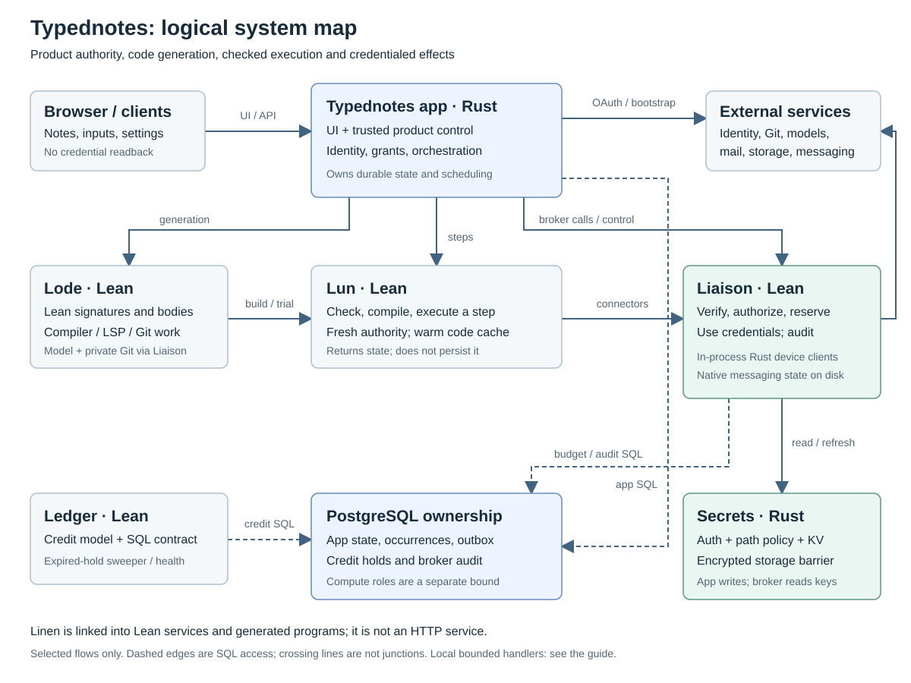

# Typednotes documentation

Start with the [implemented system architecture](system-architecture.md) for the current
service boundaries, data flows, and deployment shapes. The [architecture draft](architecture.md)
records design decisions and proposals; it is not a map of the current deployment.

## Development and releases

- [Local development](local-development.md)
- [CI verification](ci-verification.md) and [workflow policy](workflow-policy.md)
- [Coordinated push order](push-order.md)
- [Branding](branding.md)
- [Release history](../CHANGELOG.md) and release notes:
  [0.12.2](release-0.12.2.md), [0.12.1](release-0.12.1.md), [0.12.0](release-0.12.0.md),
  [0.11.0](release-0.11.0.md), [0.10.0](release-0.10.0.md), [0.9.1](release-0.9.1.md),
  [0.9.0](release-0.9.0.md), [0.8.0](release-0.8.0.md), [0.7.3](release-0.7.3.md),
  [0.7.2](release-0.7.2.md)

## Product and execution

- [Workspaces](workspaces.md) and [deletion](deletion.md)
- [Notebook UI](notebook-ui.md) and [computations](computations.md)
- [Graphs and Lode](graph-and-lode.md)
- [Scheduling ownership and recovery](scheduling-ownership.md)
- [Proof strategy and trusted boundaries](proof-strategy.md)
- [Measured Lun throughput](lun-throughput.md)

## Connectors and messaging

- [Connection contract](connections.md)
- [AI providers](ai-providers.md) and [Google connections](google-connections.md)
- [Native connectors](native-connectors.md) and [paired messaging](paired-messaging.md)

## Code and contracts

The [service index](services/README.md) distinguishes implemented components from proposed roles
and links their contracts. For the packages in this repository, start with:

- [`api` — shared server functions and core](../packages/api/SPEC.md)
- [`web` — full-stack browser app](../packages/web/SPEC.md)
- [`ui` — shared components](../packages/ui/SPEC.md)
- [`desktop` — native desktop shell](../packages/desktop/SPEC.md)
- [`mobile` — native mobile shell](../packages/mobile/SPEC.md)
