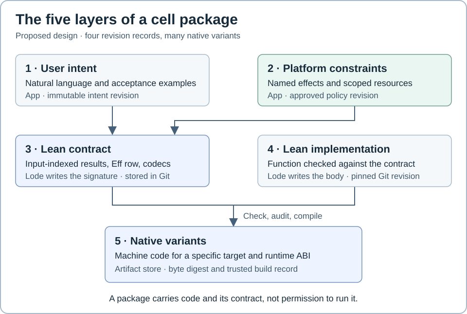
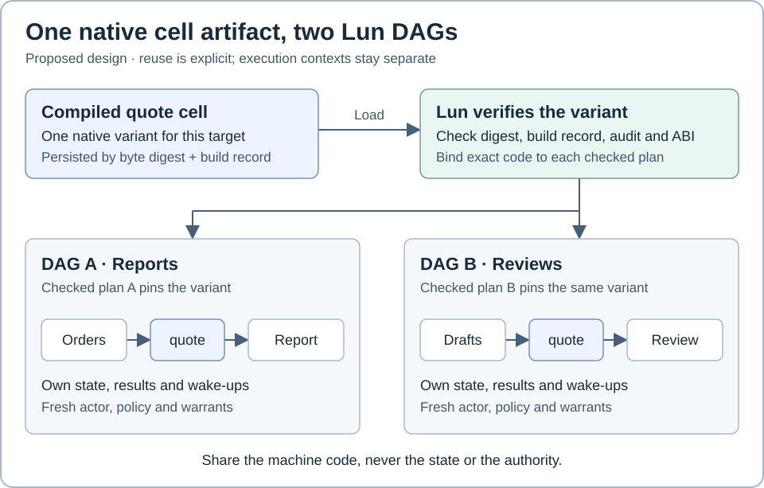

# Cell packages: from user intent to reusable native code

**Status: proposed design, not implemented.** A cell package represents one
version of a Typednotes note, independently of where it runs. **Compile the cell;
check and run the DAG; authorize every invocation.** A new graph can reuse a
compatible cell artifact without inheriting the original graph's state or authority.

Today [Lun](services/lun.md) already generates a Lean wrapper module for each
declared function, checks the graph, and links a native driver for the whole build.
Running a ready build does not recompile it. This proposal adds reuse **across**
builds and, eventually, across independently checked DAGs.

## 1. What a package represents



*Figure 1 — The four authoring records make up an immutable cell revision. Native
artifacts are derived variants, not edits to that revision.*

1. **User intent.** Preserve the exact natural-language specification and its
   revision, author and optional acceptance examples in the app. Lode uses this
   text to produce the formal signature, but type checking does not prove that it
   understood the prose.
2. **Platform constraints.** Record a versioned, approved ceiling over named
   effects and structured resources: for example, read objects under a particular
   prefix, not “S3 access.” The platform checks the compiled `Eff` row and its
   capability arguments against this ceiling. Source text or a generated manifest
   cannot grant itself additional authority.
3. **Lean contract.** Lode writes the formal spec: a Lean type signature with
   ordered inputs, result types, refinements and an effect row. The proposed
   package also references the associated wire codecs. A result type can depend
   on the actual input. Lode must preserve any caller-pinned contracts and stay
   within the platform's effect ceiling; the generated spec does not replace
   either. Properties not expressed in the type need a separate proof or test.
4. **Lean implementation.** Lode also writes the function that implements that
   signature. Pin the published repository, commit, package path, module and
   declaration. Git supplies reviewable source and provenance; a floating
   branch or a function name alone is not a build input.
5. **Native variant.** Store machine code and a build record for a specific
   target and runtime ABI. The record binds the checked source and contract to
   the exact artifact bytes. One cell revision can have variants for, say,
   Linux `amd64` and Linux `arm64`; a runner must reject an incompatible variant.

## 2. What Lean checks

For “return one subtotal in cents per input line, in order, at 200 cents per
unit, with no external effects,” the contract can make the output length depend
on the input:

```lean
import Linen.Control.Monad.Effect

open Control.Monad.Effect

structure CellSignature where
  Input : Type
  Output : Input → Type
  effects : List (Type → Type)

def CellSignature.Run (sig : CellSignature) : Type 1 :=
  (input : sig.Input) → Eff sig.effects (sig.Output input)

structure Batch where
  quantities : Array Nat

def quoteSignature : CellSignature where
  Input := Batch
  Output := fun batch => Vector Nat batch.quantities.size
  effects := []

def quote : quoteSignature.Run :=
  fun batch => pure (Vector.ofFn (fun i => 200 * batch.quantities[i]))
```

The type rules out the wrong number of subtotals and gives the function no
`Eff` operations. It does **not** say that the `i`th subtotal is correct; a
vector of zeros has the same type. For that guarantee, state and prove the
pointwise formula, or put it in the result type.

For a dependent call over JSON, the generated wrapper decodes the input first.
The output encoder and decoder are indexed by **that decoded input**. For this
example, restoring an output must check its length against the original batch
and reconstruct the `Vector` witness, not trust a length supplied by the
output or assume the DAG's latest input produced it. An exported result can
instead carry its own index as `Sigma (fun n : Nat => Vector Nat n)`; that
guarantees the count matches the vector, not a particular upstream batch. At a
DAG edge, Lean must check the actual producer/consumer types (including any
required index relationship), and their wire codecs must agree or use an
explicit checked adapter. Two values having the same JSON shape is not enough.

**Compatibility limit:** today's Lun adapter accepts non-dependent outer
function signatures with JSON dictionaries. It can already carry refined or
indexed *data inside* such a signature with suitable codecs. A wrapper for
`(input : A) → Eff row (B input)` and execution with that indexed relationship
are new work. Start with ordinary functions; extend the same design to
producers only once their emitted values, continuations, and wake-ups are
covered by the checked contract.

### Effects carry resource scopes

For an effectful cell, the platform can translate “read reports on the
approved S3 connection” into a capability used by the effect's **type**:

```lean
import Linen.Control.Monad.Effect.Connector

open Control.Monad.Effect

abbrev reports : Connector.Capability :=
  { provider := "s3", connection := "conn-1",
    scopes := [{ operation := "objects.read", root := ["reports"] }] }

def readReport (key : Connector.ScopedResource reports "objects.read") :
    Eff [Connector.Connector reports] Lean.Json :=
  Connector.callAt "objects.read" key
```

The decoder for a caller-selected key would use `ScopedResource.check?`:
`["reports", "may.csv"]` is in scope, `["reports-private", "may.csv"]` is not.
At admission, the platform must also check that `reports` narrows the
independently approved ceiling (Linen provides `Capability.checkNarrows?`).
Neither witness replaces Lun's live operation check. This example pins the
connection in the type: moving it to a different connection would need a
different compiled capability, unless a future typed binding explicitly
supports logical resource slots.

## 3. What to persist

Don't serialize Lean `Type`s, closures, proofs, or `Eff` continuations into a
database. Persist versioned references to the declarations and build evidence.
For example, these are **metadata types**, not execution witnesses:

```lean
import Lean

inductive RefKind where
  | intent | policy | contract | build | abi | blob

structure Ref (kind : RefKind) where
  sha256 : String  -- In production: a validated digest with a private constructor.

structure GitSource where
  repository : String
  commit : String
  projectPath : String
  moduleName : Lean.Name
  declaration : Lean.Name

structure CellRevision where
  intent : Ref .intent
  ceiling : Ref .policy
  contract : Ref .contract
  source : GitSource

structure NativeVariant where
  contract : Ref .contract
  buildKey : Ref .build
  targetTriple : String
  runtimeAbi : Ref .abi
  binary : Ref .blob
```

- **PostgreSQL holds app-owned metadata:** immutable intent, policy and cell
  revisions; a stable note ID and a pointer to its adopted revision; authorized
  references to native variants; and versioned DAG placements. The contract
  reference resolves to versioned, elaboratable Lean declarations and their
  codec definitions, not to a signature string that serves as proof.
- **Git holds source:** contracts, implementations and locked dependencies. Preserve
  the exact source revisions used by adopted cells so cache misses remain rebuildable.
- **An artifact store holds immutable blobs:** native objects or worker bundles
  addressed by their byte digest. A trusted build record ties the digest to the
  checked contract, target, and exact build inputs. Keep the store access-controlled
  and separate from build workspaces; a hash is not permission to fetch or run code.
  A local disk cache can serve the hot path; a warm worker is a separate cache of
  loaded code, not the source of truth.

**Use separate keys for different changes.** The cell revision identifies the
reviewed intent, ceiling, contract and Git provenance. The **build key** covers
the actual compilation and audit inputs: the cell and wrapper sources, their
transitive imports and codecs, pinned dependencies, toolchain, native target and
link inputs, and runtime/audit version. The **blob digest** identifies the
  resulting bytes. A prose-only edit can reuse a binary if those inputs match and
the new revision is admitted. A different dependency, compiled capability,
codec, or ABI can invalidate reuse even when the visible signature is unchanged.

## 4. How a Lun DAG reuses the package



*Figure 2 — A DAG placement pins an exact artifact and connects its ports. The
same artifact can back two placements; neither inherits the other's grants or state.*

1. **Check a plan.** Resolve the selected revisions and variants within the
   caller's authorized scope. Lean checks the layout against the caller's
   ordered wiring and source contracts. A checked plan should carry edge type
   evidence and earlier-node references (e.g. `Fin i` for predecessors of node
   `i`), so a runnable plan cannot contain a cycle or an unchecked connection.
   A graph edge says where values come from; a Lean `import` says what must
   be rebuilt. Rewiring an input does not, by itself, invalidate a cell object.
2. **Bind checked code.** A private loader constructs a runnable handle only
   from trusted build records, verified bytes, and a compatible runtime.
  The executor consumes that handle, not a path or symbol supplied by the
  caller. It must refuse an audit/ABI mismatch or a substituted artifact.
  Publish a build record only after its blobs are durable; adopt a plan only
  when all of its pins can be bound.
   Lean can prove the wiring and witness requirements; correspondence between
   the checked source and native bytes still trusts the builder, compiler, linker
   and isolation boundary.
3. **Run with fresh authority.** A placement can use different input values
   and locally authorized resource selections. It cannot widen the compiled
   capabilities. Lun's canonical handlers must still enforce the intersection of
   organization policy, connection permissions, cell capability and warrant
   for the actual operation and resource; Liaison independently checks
   credentialed effects. Never store credentials or live warrants in a package.
   A policy revocation denies the next affected operation even on a cache hit.
   Start with reuse within an authorized project; sharing private code across
   projects or organizations requires explicit distribution and separate grants.
4. **Keep execution state separate.** The app still owns inputs, outcomes,
   producer state and scheduling. Pin that state to the exact execution plan
   and its state codec versions. Retain the artifacts needed by active plans;
   restoring a missing artifact for an existing plan must match the pinned digest.
   Do not silently substitute a new implementation, roll forward a continuation,
   or replay effects because a worker or artifact was lost. Adoption needs
   explicit migration or reinitialization under the existing
   [recovery rules](scheduling-ownership.md).

## 5. First implementation

Start by giving generated cell modules stable identities and reusing
[Lake's native build artifacts](https://lean-lang.org/doc/reference/latest/Build-Tools-and-Distribution/Lake/#lake-cache).
Keep the existing driver and Lean graph checker. Build stale modules, recheck the
graph, and link from existing objects. An object file is a linker input, not
an executable. If checking or linking still dominates after this change, keep
the checker separate and try a generic DAG worker with separately linked,
long-lived cell workers behind a versioned protocol. Avoid a process launch
per cell execution or loading project-native code into the Lun service process.
Linen's [`System.GitFn`](https://github.com/typednotes/linen/blob/main/Linen/System/GitFn.lean)
provides commit-pinned source descriptors and worker calls. A shared Linen cell
format would use those foundations for versioned manifests, verified packages
opened from a local path or HTTPS URL, and typed calls to local or HTTP workers.
Lode would write the source and contract. Lun would attest builds, admit variants
using configured trust, and apply its producer protocol and runtime authority.
Typednotes would store immutable variants and pin the selected identity in each placement.

Use a diamond DAG to measure the first stage: a body-only edit to a cell on one
branch should rebuild that cell and its actual Lean import dependents; a
compatible rewire should rebuild **zero cell objects**. Measure artifact hits,
graph checking, native compilation, linking and warm step latency separately.
Before adopting a loader, test rejection of type/codec mismatches, stale or
replaced binaries, revoked grants and incompatible restored state, as well as
parity with the current driver's ordered outcomes. Reuse and performance gains
have not been measured.

Related: [implemented system architecture](system-architecture.md#24-lun-compiler-checked-artifact-service-and-bounded-executor),
[proof strategy](proof-strategy.md), and the
[Lun runtime guarantees](https://github.com/typednotes/lun/blob/main/docs/runtime-guarantees.md).
