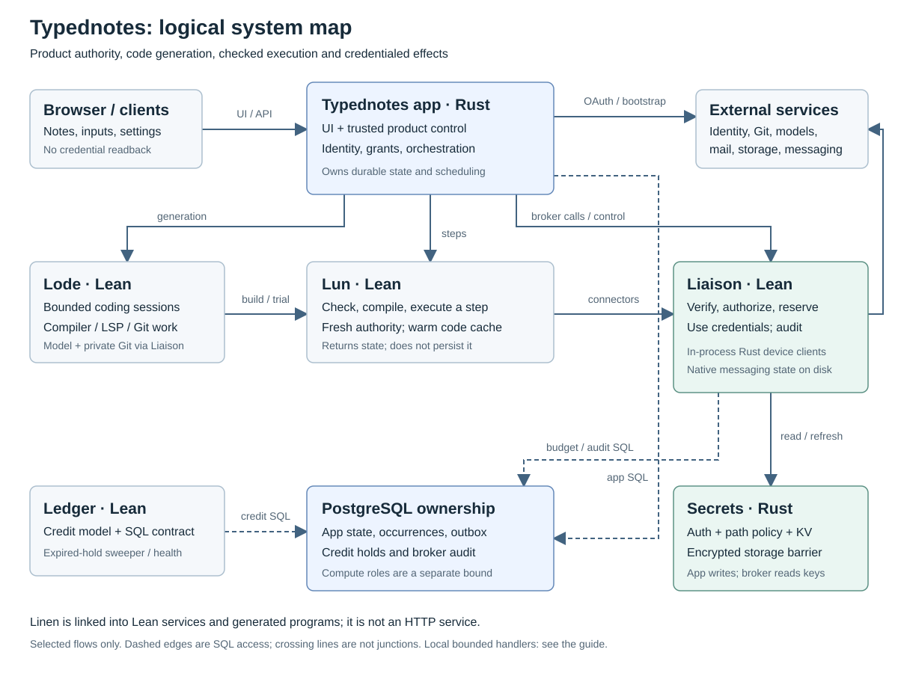
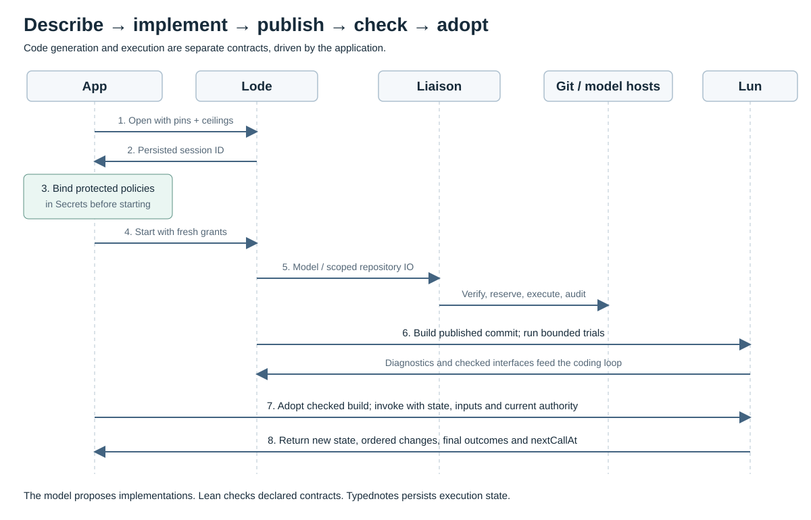
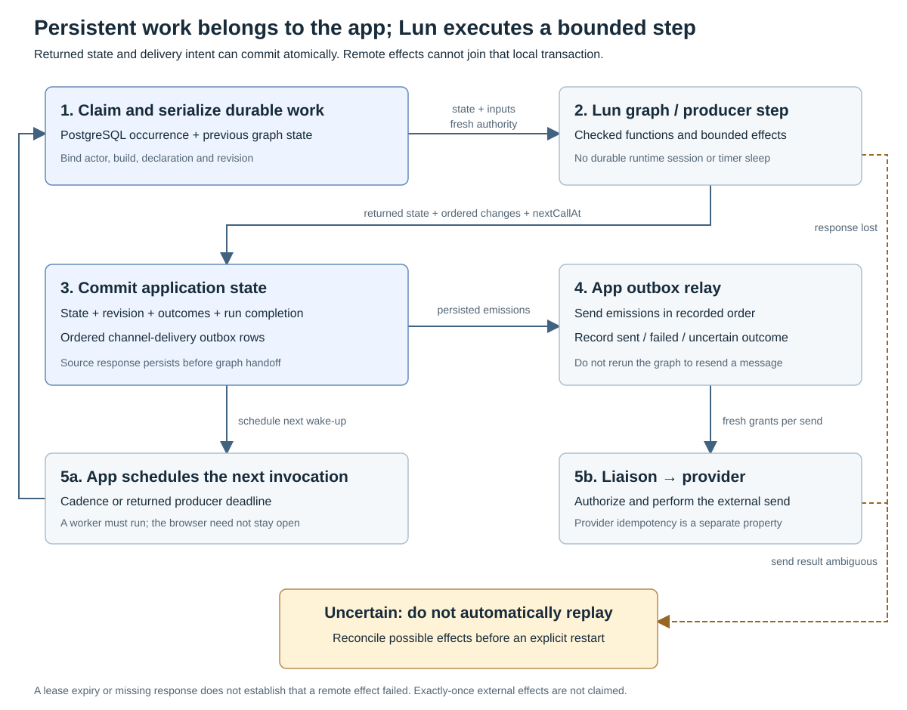
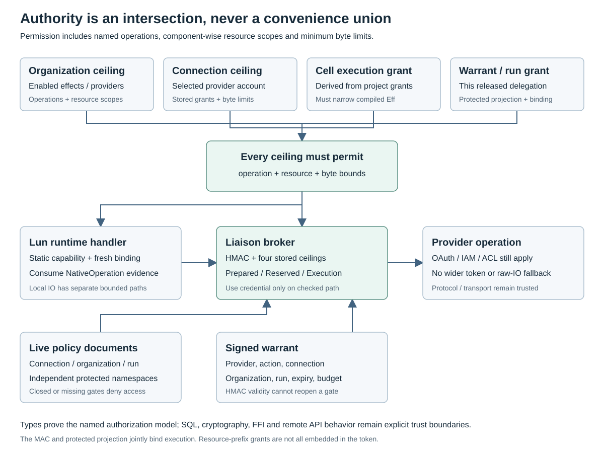
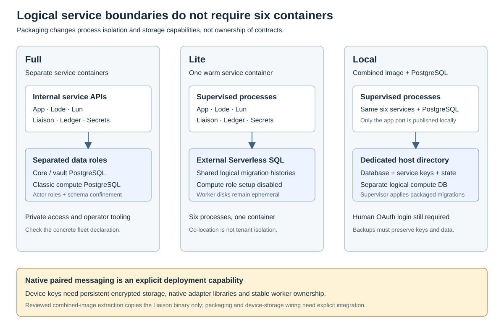

# Typednotes: implemented system architecture

**Reviewed:** 2026-10-17. **Scope:** the Typednotes v0.12.0 / Liaison v0.7.0
source contract, the stateless Lun `stateless-producers-v4` interface, and the
current sibling service and deployment implementations. This is a source-level
description, not an assertion that every feature is deployed in production.

Typednotes turns project notes into versioned, typed Lean programs. A coding
agent proposes implementations; a compiler/runtime checks their interfaces and
effects; the application durably orchestrates execution; a broker mediates
credentialed provider operations. The model is a code producer, not the authority
that decides what the resulting code may access.

## Reading map

- [1. Vocabulary and system map](#1-vocabulary-and-system-map)
- [2. Components and their exact responsibilities](#2-components-and-their-exact-responsibilities)
- [3. From a note to a checked implementation](#3-from-a-note-to-a-checked-implementation)
- [4. Execution, scheduling and failure recovery](#4-execution-scheduling-and-failure-recovery)
- [5. Authority, credentials and effect boundaries](#5-authority-credentials-and-effect-boundaries)
- [6. Storage ownership and deployment shapes](#6-storage-ownership-and-deployment-shapes)
- [7. What is proved, tested or still trusted](#7-what-is-proved-tested-or-still-trusted)
- [8. Comparisons and further reading](#8-comparisons-and-further-reading)
- [9. Keeping this description current](#9-keeping-this-description-current)

The older [architecture draft](architecture.md) records design decisions and
proposals. Its diagrams are not the current deployment map. Detailed contracts
remain in [native connectors](native-connectors.md), [connections](connections.md),
[scheduling ownership](scheduling-ownership.md), [paired messaging](paired-messaging.md)
and each service repository. Implementation links below are the entry points to
check when changing this guide.

## 1. Vocabulary and system map

**Organization → project → notes** is the current product hierarchy. A note is a
source, a calculation or a sink. Project-level connection grants and a selected
model govern note implementation and use. A project has a canonical graph;
historical `graph_cells`, graph IDs, graph routes and some notebook names remain
in storage and APIs. They do not imply a separate notebook-creation layer.

A **function** is compiled Lean code under a declared signature. A **graph** wires
declared functions and typed inputs into an acyclic dependency structure. A
**producer** is a resumable typed step that can emit several values, return a
serializable continuation and request a future wake-up. A **connection** is an
organization-owned provider account and its permission ceiling; its creating
user remains the credential owner. An **interface** binds a messaging address to
a project. A **warrant** is short-lived delegated execution authority, not an
OAuth access token.



*Figure 1 — Logical components and selected flows. Boxes denote responsibilities,
not necessarily containers. Bounded local runtime handlers have additional paths
explained in §5; this is not an exhaustive network-policy diagram.*

There are six principal application processes: **Typednotes app, Lode, Lun,
Liaison, Secrets and Ledger**. `core`, `web`, `agent` and `broker` in older design
documents are logical roles: `core` and `web` currently live in the Rust app;
the implemented code-writing agent is Lode; the broker implementation is Liaison.
A standalone Typednotes IdP is a proposal, not a required deployed service.

## 2. Components and their exact responsibilities

### 2.1 Typednotes app: product authority and durable orchestration

**Implementation:** Rust, Dioxus 0.7 fullstack. The browser UI is in
[`packages/ui`](../packages/ui); [`packages/web/src/main.rs`](../packages/web/src/main.rs)
mounts it, serves the backend and starts background work. Shared API types and
server functions live in [`packages/api/src/lib.rs`](../packages/api/src/lib.rs).
The browser does not receive backend database, vault or service credentials.
Desktop/mobile packages reuse the UI; their presence does not create additional
backend services.

The app owns users, identities, sessions, memberships, organization policies,
projects, note declarations, project grants, connection metadata, publication
choices, input/output history and public shares. It also owns generation requests,
execution state/revisions, due times, durable scheduled occurrences and delivery
outboxes. Its Rust/SQL authorization decisions are part of the trusted control
plane; they are not covered by the runtime's Lean proofs.

The app authenticates humans with its configured GitHub/Google login flows and
maintains its own session cookie. Connecting a provider account is a separate
grant from signing in. OAuth exchanges/bootstrap contact providers directly;
later delegated connector effects follow the broker path. The app writes
third-party credentials into Secrets but its vault identity must not read them
back. It publishes protected policy/run documents and mints fresh warrants.

**Main implementation owners:**
[`session.rs`](../packages/api/src/server/session.rs),
[`oauth.rs`](../packages/api/src/server/oauth.rs),
[`projects.rs`](../packages/api/src/server/projects.rs),
[`graphs.rs`](../packages/api/src/server/graphs.rs),
[`connector.rs`](../packages/api/src/server/connector.rs),
[`warrant.rs`](../packages/api/src/server/warrant.rs),
[`shares.rs`](../packages/api/src/server/shares.rs), and
[`deletion.rs`](../packages/api/src/server/deletion.rs).

### 2.2 App scheduler and outbox relay: persistent work, not sleeping graphs

These are modules/background tasks of the app, not a seventh independently
packaged scheduler service. [`scheduler.rs`](../packages/api/src/server/scheduler.rs)
claims due work, records stable occurrences and invokes checked source functions
or graph steps. Graph lifecycle code serializes state changes against input edits,
adopts checked builds and persists results. Channel delivery uses the ordered
`graph_delivery_outbox` rather than rerunning a graph to resend one message.

Durability comes from PostgreSQL records and transactions, not an in-memory timer
or a permanently running browser. A worker still has to be running to dispatch
due work. Current source cadence is UTC with overdue checks coalesced; selectable
timezones, arbitrary missed-run policies and independently packaged scheduler
workers are not implemented. See [§4](#4-execution-scheduling-and-failure-recovery).

### 2.3 Lode: bounded code-writing agent and development loop

**Implementation:** Lean service in [`typednotes/lode`](https://github.com/typednotes/lode).
Lode turns descriptions into Lean modules and `lun.json` in a shared Git branch.
It owns coding sessions, a checkout, diagnostics and an append-only interaction
log. It does not own the application's durable graph execution state.

Its agent-computer interface includes scoped file tools, compiler/LSP feedback,
publication, Lun builds and bounded runtime trials. This resembles the tool-driven
software-engineering loop studied by SWE-agent, with different languages,
contracts and containment requirements; no benchmark equivalence is implied.[^swe]

The app supplies caller-pinned source/output/wiring contracts, selected model,
organization tool ceiling and authenticated execution bounds. Lode narrows tools
against the selected agent and live session policy; credentials-only refresh
cannot restore removed authority. Bounded questions can pause generation for the
initiating user. Model and credentialed repository calls use Liaison. Tool
arguments and `lun_call` inputs do not let the model manufacture its own actor,
service list, credential or wider runtime envelope.

An allowed shell or a project's Lakefile is still executable code. Named-tool
permissions and Lean effect rows are not an operating-system sandbox.

**Interface:** `/v0/sessions`, messages/log polling, abort and credential refresh.
**Source:** [Server](https://github.com/typednotes/lode/blob/main/Lode/Server.lean),
[Session](https://github.com/typednotes/lode/blob/main/Lode/Session.lean),
[runtime bridge](https://github.com/typednotes/lode/blob/main/docs/runtime-bridge.md),
[build contracts](https://github.com/typednotes/lode/blob/main/docs/build-contracts.md).

### 2.4 Lun: compiler, checked artifact service and bounded executor

**Implementation:** Lean service in [`typednotes/lun`](https://github.com/typednotes/lun).
Lun fetches a pinned project, checks declarations, compiles a driver and exposes
named functions and graph-step entry points. It verifies signatures, JSON
dictionaries, allowed effect rows, graph wiring and caller-pinned contracts. Its
closure audit rejects unsupported unsafe/extern/raw-IO escape paths in served
code; project build code still requires a separate trusted isolation boundary.

Lun owns build artifacts, diagnostics and bounded warm compiled-worker caches.
Warm workers retain loaded code and actor/entry-point affinity, not durable
execution history or reusable request authority. Each call rebuilds an execution
context with fresh authenticated binding, policy and grants.

A graph request supplies previous `state` and changed `inputs`; the response
contains `state`, final `nodes`, ordered `changed` outcomes and `nextCallAt`.
Lun does not persist that state, schedule the next invocation or expose the old
graph-session API. Functions may fail locally, block dependents and later recover.
Producers can emit zero or several values; they yield a continuation instead of
holding a service thread asleep until the next occurrence.

**Interface:** `/v0/builds`, build status/log, `/functions/{name}` and
`/graphs/{name}` under a build. **Source:**
[API](https://github.com/typednotes/lun/blob/main/Lun/Api.lean),
[build pipeline](https://github.com/typednotes/lun/blob/main/Lun/Build.lean),
[driver template](https://github.com/typednotes/lun/blob/main/template/LunDriver/Runtime.lean),
[worker cache](https://github.com/typednotes/lun/blob/main/Lun/WorkerCache.lean).

### 2.5 Linen: linked programming and proof library

[`typednotes/linen`](https://github.com/typednotes/linen) is a Lean library, not an
HTTP service or a scheduler. Services and generated programs link its effect
system, reactive graph machinery, data structures, HTTP/SQL clients and native
FFI. `Eff` rows name allowed effects and capabilities constrain their operations
and resource arguments. Canonical handlers interpret these requests at runtime.
This separates effect descriptions from interpreters in the sense of algebraic
effects/handlers; Linen uses a freer-style implementation, not a claim to
implement every semantics in the effects literature.[^effects]

Its reactive library is broader than Lun's accepted graph language. Lun admits
typed inputs, applications of declared functions and its bounded producer
contract; it does not accept arbitrary reactive operators merely because Linen
exports them. Incremental dependency propagation invites comparison with dataflow
systems such as Naiad, but this runner is not Naiad's distributed, cyclic,
timestamp/progress-tracking engine.[^naiad]

**Source:** [effects](https://github.com/typednotes/linen/tree/main/Linen/Control/Monad/Effect),
[connector authority](https://github.com/typednotes/linen/blob/main/Linen/Control/Monad/Effect/Connector.lean),
[reactive graphs](https://github.com/typednotes/linen/tree/main/Linen/Control/Reactive).

### 2.6 Liaison: credentialed-effect broker

**Implementation:** Lean service in [`typednotes/liaison`](https://github.com/typednotes/liaison),
with C/native transport boundaries and in-process Rust messaging adapters.
Liaison verifies HMAC warrants and their caveats, reserves declared credits,
reloads independent live ceilings and the run projection, validates the named
operation/resource/payload, resolves necessary provider relationships, fetches
the credential, executes, audits and settles/releases the hold.

Callers name operations and component-wise resources. The broker derives
authentication, provider URLs/methods and supported payloads. Unknown shapes fail
closed; a denied native call has no unrestricted HTTP fallback. OAuth refresh is
broker-owned where configured. Git publication uses scoped native plans and
expected-head conditions rather than giving Lode a reusable provider token.

The ordinary delegated endpoint is `POST /v0/egress`. It is the credentialed
connector chokepoint, not a universal network proxy: OAuth/bootstrap, bounded
anonymous runtime HTTP, local compute/vault handlers and infrastructure control
have distinct paths described below.

**Source:** [Server](https://github.com/typednotes/liaison/blob/main/Liaison/Server.lean),
[Auth](https://github.com/typednotes/liaison/blob/main/Liaison/Auth.lean),
[Connector](https://github.com/typednotes/liaison/blob/main/Liaison/Egress/Connector.lean),
[Provider](https://github.com/typednotes/liaison/blob/main/Liaison/Egress/Provider.lean),
[Budget](https://github.com/typednotes/liaison/blob/main/Liaison/Budget.lean).

### 2.7 Native paired messaging: protocol clients inside Liaison

Presage (Signal) and `whatsapp-rust` run as native libraries in the broker process,
not additional CLI daemons. A small C ABI dispatches checked Lean plans into
provider-specific Rust adapters. Separate libraries avoid their incompatible
SQLite dependency versions.

`POST /v0/device` serves signed owner-bound pairing/status/unlink controls minted
only by the app's owner/admin flow. These are provisioning actions, absent from
notebook operation catalogs and presets. Paired `messages.read`/`messages.send`
remain ordinary four-ceiling connector effects. Pairing does not grant sending.

The broker owns device keys, protocol connections and bounded recent-message
storage. Direct-text reads filter the selected peer before serialization. The
app persists per-selector delivery cursors; this is not an unlimited message
archive. Device locks and explicit actor shutdown govern worker ownership and
cleanup. Remote logout semantics depend on the provider library.

These sessions introduce a durable disk requirement: **persistent encrypted
storage**, worker affinity/locking and the native libraries must be provisioned.
Signal additionally uses SQLCipher; the shared inbox uses per-connection
encryption; WhatsApp's protocol database relies on volume encryption. See
[paired messaging](paired-messaging.md) and
[native adapter source/contract](https://github.com/typednotes/liaison/tree/main/native).

### 2.8 Secrets: authenticated, encrypted storage and policy gate

**Implementation:** Rust service in [`typednotes/secrets`](https://github.com/typednotes/secrets).
Its axum server composes auth methods, path/capability policies and secret engines
over an encrypted PostgreSQL storage barrier. The design is comparable to the
auth → policy → secret-engine separation in Vault/OpenBao, with a deliberately
smaller implementation, not blanket Vault API/HA/seal compatibility.[^openbao]

For this integration, the important surface is authenticated KV storage:
third-party credentials, independent connection ceilings, live organization
ceilings, warrant-keyed run projections, graph secrets and bound compute
credentials. The app has credential write/delete and protected-policy publication
rights; Liaison has the necessary provider credential read/refresh rights; Lun
has its bounded local compute/graph-secret identity. Generated programs receive
neither the vault service password nor a raw storage handle.

Secrets also implements dynamic/delegation engines, but their existence does not
mean Typednotes uses every one, or that every issued provider token is independently
revocable/downscoped. Current warrant attenuation restricts application execution;
it does not magically narrow an underlying OAuth token's provider-side scope.

**Source:** [composition root](https://github.com/typednotes/secrets/blob/main/crates/secrets-server/src/wiring.rs),
[core/barrier](https://github.com/typednotes/secrets/tree/main/crates/secrets-core),
[app vault client](../packages/api/src/server/vault.rs).

### 2.9 Ledger: credit model, shared SQL and expired-hold sweeper

**Implementation:** Lean library/service in [`typednotes/ledger`](https://github.com/typednotes/ledger).
It owns the credit/usage/hold schema and arithmetic/lifecycle model. The serving
binary runs an expired-hold sweeper and `/health`. App grants and Liaison's
reserve/settle/release path issue SQL directly against the shared ledger tables;
there is not a synchronous billing-HTTP hop for every connector request.

Balances are derived from entries, with active holds deducted from spendable
credit. Local type/proof bounds such as settlement ≤ reservation do not establish
cross-transaction no-overspend: the current reserve implementation has a documented
concurrent `READ COMMITTED` race. Declared broker call cost is not automatically
measured model-token usage, a provider invoice or a tax calculation. Stripe/Paddle
and a generalized billing engine in older proposals are not established features
of this request path.

**Source:** [entry point](https://github.com/typednotes/ledger/blob/main/Main.lean),
[ledger SQL](https://github.com/typednotes/ledger/tree/main/Ledger/Sql),
[broker reservation implementation](https://github.com/typednotes/liaison/blob/main/Liaison/Budget.lean).

### 2.10 Infrastructure engine, fleet declaration and packaging supervisor

[`infra`](https://github.com/typednotes/infra) is the reusable Lean infrastructure
engine: typed desired/observed state, provider backends, planning and apply. It
is a Terraform/OpenTofu-style deployment tool, not a runtime note executor.
[`typednotes-infra`](https://github.com/typednotes/typednotes-infra) is its consumer:
the concrete fleet, service access policies, migration histories, image assembly,
configuration and Lite/Local process supervision.

A service tag, a container image, a migration source and an applied deployment
are different artifacts. Publishing one does not prove the others are installed.
Service code owns SQL history; fleet/packaging orchestration applies the selected
history before serving. Service binaries do not silently migrate production at
startup. The Local launcher is a packaging-level exception: its supervisor
initializes the bundled PostgreSQL roles and applies packaged, checksum-checked
migrations before starting the services.

**Source:** [fleet](https://github.com/typednotes/typednotes-infra/blob/main/Fleet.lean),
[Lite declaration](https://github.com/typednotes/typednotes-infra/blob/main/Fleet/Lite.lean),
[image assembly](https://github.com/typednotes/typednotes-infra/tree/main/images),
[Local packaging](https://github.com/typednotes/typednotes-infra/tree/main/local).

### 2.11 Names that are not additional current product services

- **`web` / `core`:** UI and trusted product-control roles of the Rust app,
  rather than the proposed standalone Lean core in older service sketches.
- **`agent`:** a generic logical role; Lode is the implemented code-writing agent.
  A model provider is external inference, not the authority that grants access.
- **`idp`:** a proposed Typednotes OIDC/passkey provider. Current human login uses
  the app's external identity-provider flows and app-owned sessions.
- **PostgreSQL:** actual persistent infrastructure, with separate ownership/roles
  described in §6; it is not an agent and does not compile notes.
- **Git host, AI host, object store, mail/calendar/messaging providers:** external
  resource systems accessed through the appropriate connector/protocol path.
- **Build tooling, Lean LSP and native adapters:** subprocesses/libraries inside
  the responsible service's trust domain, not independently user-facing services.

## 3. From a note to a checked implementation



*Figure 2 — The application binds protected run policy after obtaining the actual
writer session ID. Publication identifies code; adoption identifies the checked
artifact used for execution.*

1. The app saves the note declaration and caller-owned constraints, with a durable
   generation/retry identity. Inputs and output types can be user-pinned; coherent
   unpinned type evolution is distinct from changing a caller's explicit contract.
2. It opens Lode with repository/model selection, tool and execution ceilings and
   build contracts. Background checkout is acknowledged separately from completion.
3. After receiving the persisted Lode session ID, the app publishes protected
   conversation/publication refinements and starts generation with fresh grants.
4. Lode iterates model calls, named tools, compiler/LSP diagnostics, publication,
   Lun builds and bounded calls. An effect refusal is feedback, not permission
   to substitute raw HTTP/SQL or a broader credential.
5. The app reads the published manifest at an immutable commit, supplies its own
   contracts and asks Lun to check/build it. It adopts the ready build only when
   its declared functions, sources, outputs and wiring match the caller's bounds.
6. Inputs and current grants run against that build. Future implementation changes
   produce a new checked artifact; a coding-session transcript is not the runtime
   source of truth.

This separates model-driven development from serving a bounded program. Compiler
success proves interface/proof obligations, not that the function faithfully
implements the user's natural-language intent.[^lean]

## 4. Execution, scheduling and failure recovery



*Figure 3 — PostgreSQL holds work and state. Lun returns a bounded step. Delivery
is a separately recorded effect; a lost response is not proof that nothing ran.*

The essential split is:

```text
Lun:       step(checked build, previous state, inputs, fresh authority)
             → updated state, ordered changes, final outcomes, nextCallAt
Typednotes: persist/revise → arrange wake-up → invoke the next bounded step
```

Source occurrences snapshot actor/build/declaration identity. A source result is
persisted as `input_ready` before graph delivery, so recovering that handoff does
not refetch the source. Producers instead resume their typed continuation at a
returned deadline. Input edits replace obsolete continuations under the app's
serialization rules.

Graph state, outcome history, occurrence completion and channel-emission outbox
rows are committed by the app. The relay sends emissions in order with newly
minted live authority. This is a transactional-outbox pattern; it does not make
the provider's side effect part of the PostgreSQL transaction.[^outbox]

If a graph/source/send response is lost after dispatch, the effect may already
have happened. Expired dispatch leases and ambiguous sends become `uncertain`;
automatic replay is blocked pending reconciliation/explicit restart. Exactly-once
external effects are not claimed. Temporal is a useful comparison for durable
orchestration, but Typednotes does not run Temporal or implement its complete
workflow-history replay model; Temporal also documents the need for idempotent
external activities.[^temporal]

**Source of truth:** [`0015_durable_schedules.sql`](../migrations/0015_durable_schedules.sql),
[`scheduler.rs`](../packages/api/src/server/scheduler.rs),
[`graphs.rs`](../packages/api/src/server/graphs.rs), and
[scheduling ownership](scheduling-ownership.md).

## 5. Authority, credentials and effect boundaries



*Figure 4 — Permission is the intersection, not the union, of independent bounds.
Lun additionally checks narrowing against the compiled static `Eff` capability.*

### Four ceilings plus the compiled contract

The named runtime/broker authority has four independent ceilings:

1. **Organization:** enabled effects/providers and organization operation/resource
   ceilings.
2. **Connection:** the connected account's explicit operation/resource and byte
   limits.
3. **Cell execution grant:** the live grant derived by the app from project note
   selections and the particular operation/resource. Project-level UI permissions
   do not remove this execution-layer concept.
4. **Warrant/run grant:** protected authority for this specific released delegation.

An operation/resource must be permitted by all four. Request/response limits take
the minimum. Lun also requires the live cell grant to narrow the function's
compiled capability; changing serialized state cannot restore removed authority.
Provider OAuth/IAM/ACL grants are additional ceilings, not substitutes for these
application permissions. Lode has a further named-tool/agent/session bound.

### What the warrant actually authenticates

The scheme is **macaroon-style chained HMAC**, not Biscuit, a public-key JWT or a
claim of compatibility with every macaroon feature.[^macaroons] The app mints;
Liaison verifies. Caveats explicitly bind provider/action, connection, run,
expiry and budget, while organization identity is included in the root MAC input.
Resource-prefix grants and owner bindings also rely on the protected live
documents; the MAC alone is not a self-contained copy of every permission.

The broker reads separate connection permissions, organization policy and a
warrant-keyed run projection. That projection binds the credential owner and
the cell/warrant capabilities. Policy/declaration deletion closes gates and
removes projections before acknowledgement. A still-valid HMAC does not reopen
revoked authority. Calls already admitted use their fetched snapshot; this is
not instantaneous retroactive cancellation or a separate token-ID blacklist.

This follows least privilege and complete mediation as design principles, while
the actual checked entry points and deployment ACLs determine enforcement.[^protection]
It is not Zanzibar's global relationship/consistency service: membership and
resource ownership currently live in app SQL.[^zanzibar]

### Where each effect executes

- **Connector / ObjectStore:** Lun checks static/live bounds, then Liaison verifies
  the external warrant, reserves credits and uses provider credentials.
- **PostgreSQL:** Lun resolves an actor-bound compute credential and executes a
  structured, parameterized query under a schema/role witness. Provisioning that
  role is trusted app work, separate from note execution.
- **SecretStore:** Lun resolves declared graph-scoped names with its own private
  vault identity. Local native projections are checked, but their HMAC is not
  independently verified by Lun as external warrants are by Liaison.
- **Anonymous HTTP:** Lun enforces static scope, organization domains, standard
  ports and public DNS/address evidence, pins transport and refuses redirects.
  It contacts the public endpoint directly; no provider credential or broker
  metering/audit row is implied by this path.
- **Temporary FileSystem:** Lun uses actor/organization-confined paths and
  descriptor-relative syscall checks; it is not arbitrary container filesystem IO.
- **Trace / Error:** runtime-local diagnostics/outcomes. Public shared graph calls
  receive only these effects, fresh restricted context and isolated visitor state.

The app's OAuth/provisioning traffic, Secrets' own engines and infrastructure
provider calls are separate trusted control-plane paths. Thus “Liaison is the
chokepoint” must always be qualified as credentialed delegated connector effects.

## 6. Storage ownership and deployment shapes

### Data ownership survives process co-location

- **App PostgreSQL:** product identities, ownership/policies, declarations,
  generation/run state, schedules, outbox, public visitor state and message/cursor
  records. App migrations are in [`migrations/`](../migrations).
- **Ledger tables:** credits/holds/usage, shared with app grant SQL and broker
  reservation SQL. **Liaison audit tables:** attempts/outcomes owned by broker SQL.
- **Vault storage:** encrypted values, auth/policy/token/lease state behind Secrets.
  Logical secret paths and native device metadata have their own stated visibility;
  encryption is not a claim that all metadata is hidden.
- **Compute PostgreSQL:** provisioned actor roles/schemas for note database effects.
  A credential's owner and the executing user can differ for shared connections;
  compute and temporary-file confinement follow the executing actor.
- **Git repository:** durable published Lean source, manifest and immutable commit
  identities. It does not contain provider tokens or act as the execution-state DB.
- **Lode/Lun disks:** writer checkout/logs and compiled build/package caches. Lost
  caches can require reconstruction; uncommitted writer work can be lost.
- **Paired-device disk:** protocol identities/keys and recent encrypted inboxes.
  These require explicit durable encrypted storage; they are not disposable caches.



*Figure 5 — Same logical services, different physical packaging. A single image
does not merge service identities or provide container-level isolation between
its processes.*

**Full:** separate application/support containers, core and vault databases, and
a classic compute PostgreSQL instance. The fleet declares private service access
and an operator-only database inspector. Inspector access is an operator facility,
not an application/model tool. Check the actual fleet for versions and endpoints.

**Lite:** one warm container supervising six application processes, with external
Serverless SQL. Logical migration histories share that database. Built-in compute
role provisioning/`db` sinks are disabled because that database cannot create the
required actor roles. Worker disks are ephemeral.

**Local:** a combined image also runs PostgreSQL, persisting a dedicated host
directory containing database state, service keys and worker state. Compute is a
separate logical database on the same PostgreSQL server; Local still requires
configured human OAuth login. The supervisor, not an individual service binary,
applies the exact packaged SQL history before serving.

**Current paired-device packaging boundary:** the standalone Liaison image builds
the adapters. The reviewed combined-image
[artifact extractor](https://github.com/typednotes/typednotes-infra/blob/main/images/artifact.Dockerfile)
copies the Liaison executable only, not its new Rust libraries or their environment
wiring. Neither a new source tag nor Local's general-purpose data mount by itself
establishes QR support in a combined image. Packaging, persistent encrypted device
storage and routing must be explicitly integrated/verified; stock Lite's ephemeral
disk does not satisfy the requirement.

Deployment sources:
[fleet README](https://github.com/typednotes/typednotes-infra/blob/main/README.md),
[Local lifecycle](https://github.com/typednotes/typednotes-infra/blob/main/local/README.md),
[image assembly](https://github.com/typednotes/typednotes-infra/blob/main/images/README.md),
and [release promotion policy](workflow-policy.md).

## 7. What is proved, tested or still trusted

Lean kernel checking establishes the stated propositions over the checked model
and consumed witnesses: attenuation/narrowing, four-ceiling resource permission,
typed graph/source/output/wiring correspondence, bounded native plans and local
settlement inequalities. Relevant proof-carrying values include Linen's
`AuthorizedResource`, Lun's `NativeOperation`, Lode's authorized tool/runtime-call
witnesses and Liaison's `Authorized`, `Reserved`, `Prepared`, `Plan` and `Execution`.

Rust product authorization/minting, SQL transactions/ACLs, vault policy
provisioning, wire correspondence, compilers/build scripts, process isolation,
FFI/syscalls, cryptographic implementations, native protocol libraries and remote
provider behavior remain explicit trust boundaries. `Eff` is not a universal
proof that arbitrary Lean metaprograms or allowed shell commands are harmless.

Tests exercise parsers, transport/storage correspondence, real compiled
app/Lode/Lun/broker paths, four-ceiling denials and native-library behavior. A
passing local fixture does not certify every live provider, production volume,
deployment topology or Linux image. Compiler checks also do not establish model
quality, natural-language intent, secrecy of deliberately returned secret values,
global concurrent no-overspend or exactly-once external effects.

Use [proof strategy](proof-strategy.md) for the vocabulary, and the actual
[Lun runtime guarantees](https://github.com/typednotes/lun/blob/main/docs/runtime-guarantees.md)
and [Liaison connector guarantees](https://github.com/typednotes/liaison/blob/main/docs/connector-permissions.md)
for current theorem/transport boundaries.

## 8. Comparisons and further reading

These references explain design choices or useful comparisons; they are not a
claim that Typednotes implements, embeds or inherits all guarantees of those systems.

- **Spreadsheet/reactive dataflow:** dependencies determine incremental
  recomputation. Naiad provides a contrasting distributed/cyclic design; Lun's
  admitted graph language and caller-owned steps are deliberately narrower.[^naiad]
- **Effect handlers and Lean:** separate requested effects from their authorized
  interpreters; carry proof obligations in checked interfaces. Neither replaces
  the operational trust boundary.[^effects][^lean]
- **SWE-agent:** a model works through an agent-computer interface with code and
  test feedback. Lode adds this project's Lean/build contracts and delegated
  authority; interface checking is separate from semantic correctness.[^swe]
- **Macaroons and protection principles:** attenuate delegated authority and
  mediate use close to the credential, rather than relying on prompt instructions.[^macaroons][^protection]
- **Zanzibar:** a useful future comparison for relationship-heavy authorization,
  not a description of current app membership queries or consistency guarantees.[^zanzibar]
- **Temporal and transactional outbox:** distinguish durable orchestration,
  recorded delivery intent and actual external effects. Recovery still needs
  idempotency or explicit treatment of ambiguous outcomes.[^temporal][^outbox]
- **Vault/OpenBao:** centralize authentication, secret policy and encrypted storage;
  keep that role distinct from project ownership and provider-operation policy.[^openbao]

[^protection]: J. H. Saltzer and M. D. Schroeder, *The Protection of Information in Computer Systems*, Proceedings of the IEEE, 1975. [Author-hosted paper](https://web.mit.edu/Saltzer/www/publications/protection/).
[^macaroons]: A. Birgisson et al., *Macaroons: Cookies with Contextual Caveats for Decentralized Authorization in the Cloud*, NDSS, 2014. [Publication and abstract](https://research.google/pubs/macaroons-cookies-with-contextual-caveats-for-decentralized-authorization-in-the-cloud/).
[^effects]: G. Plotkin and M. Pretnar, *Handlers of Algebraic Effects*, ESOP, 2009, pp. 80–94. [DOI](https://doi.org/10.1007/978-3-642-00590-9_7).
[^lean]: L. de Moura and S. Ullrich, *The Lean 4 Theorem Prover and Programming Language*, CADE, 2021. [DOI](https://doi.org/10.1007/978-3-030-79876-5_37).
[^naiad]: D. G. Murray et al., *Naiad: A Timely Dataflow System*, SOSP, 2013, pp. 439–455. [DOI](https://doi.org/10.1145/2517349.2522738).
[^swe]: J. Yang et al., *SWE-agent: Agent-Computer Interfaces Enable Automated Software Engineering*, 2024. [Paper](https://arxiv.org/abs/2405.15793).
[^zanzibar]: R. Pang et al., *Zanzibar: Google's Consistent, Global Authorization System*, USENIX ATC, 2019. [Paper and abstract](https://www.usenix.org/conference/atc19/presentation/pang).
[^temporal]: Temporal documentation, *Activity Definition*, especially idempotency and retry behavior; reviewed 2026-10-17. [Documentation](https://docs.temporal.io/activity-definition).
[^outbox]: C. Richardson, *Transactional Outbox*, Microservices.io; reviewed 2026-10-17. [Pattern and failure modes](https://microservices.io/patterns/data/transactional-outbox.html).
[^openbao]: OpenBao documentation, *What is OpenBao?*; reviewed 2026-10-17. [Auth, policy and secret-engine separation](https://openbao.org/docs/what-is-openbao/).

## 9. Keeping this description current

Update this guide and its SVGs with the same change that modifies a service
boundary, ownership rule, API, policy, effect path, durable state or deployment
shape. Check source links rather than copying an older prose description. Keep
planned, locally tested, published and deployed states distinct. Do not replace a
named trusted boundary or test result with an unqualified proof claim.

The diagrams are editable, self-contained SVG files under [`diagrams/`](diagrams),
with titles/descriptions and no external fonts, scripts or image dependencies.
Update their arrows, labels and accompanying prose together; render-check text
fit and links after editing. `AGENTS.md` makes this a repository-wide rule.
