# Typednotes at a glance

Typednotes turns a project's notes into a reactive program. A note can supply
data, compute a value, or deliver a result. You describe what should happen;
the app owns who may do it, Lode writes both the Lean type signature and its
implementation, Lun checks and runs the code, and Liaison mediates credentialed
operations on your behalf.

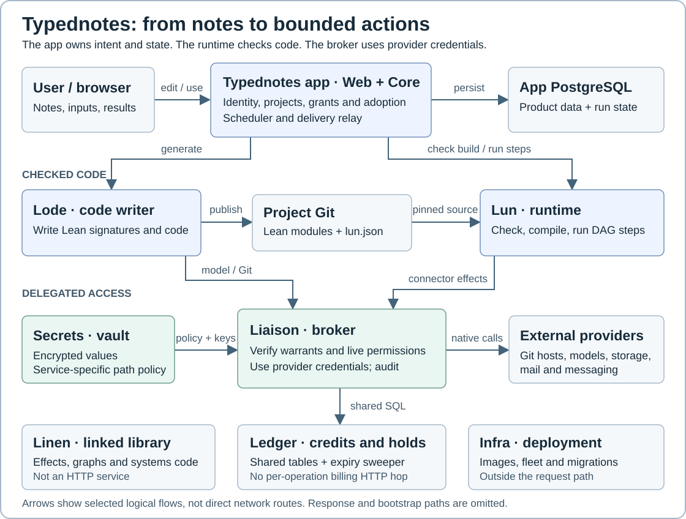

*Selected flows in the source architecture, not a live deployment inventory.
Boxes show logical roles; they do not imply separate containers. The diagram
omits direct OAuth/bootstrap traffic and Lun's separately bounded local effects.*

**Follow one note:** The app saves the user's description and bounds. Lode writes
the formal signature (the cell's Lean spec) and the function that implements it,
tests them, and publishes both if authorized. The app asks Lun to build the
pinned commit and adopts the checked graph. When an input arrives
or work is due, the app calls Lun with prior state and fresh, narrow authority.
The app stores what changed and schedules the next step. If the step needs a
credentialed connector operation, Liaison authorizes and performs it.

Jump to [App](#app), [Scheduling and delivery](#scheduling-and-delivery),
[Lode](#lode), [Lun](#lun), [Linen](#linen), [Liaison](#liaison),
[Paired messaging](#paired-messaging), [Secrets](#secrets), [Ledger](#ledger),
or [Deployment](#deployment).

## App

The Rust/Dioxus app is the product control plane: it signs users in, manages
organizations, projects and connections, and decides which graph build to
adopt. Its PostgreSQL database owns note declarations, graph state and history.
GitHub/Google login establishes a user session; connecting a provider account
grants a separate, bounded capability. The browser gets neither provider keys
nor backend service credentials.

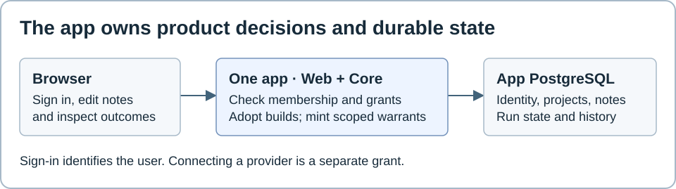

See the [Web](services/web.md) and [Core](services/core.md) roles.

## Scheduling and delivery

The scheduler and delivery relay are background work **inside the app**. The
app claims due work in PostgreSQL, calls Lun, and persists returned state,
outcomes and any outbound delivery records. It sends those records separately
through Liaison instead of rerunning the graph. An ambiguous response from an
effectful call becomes uncertain; the app does not automatically replay an
effect that may have succeeded.

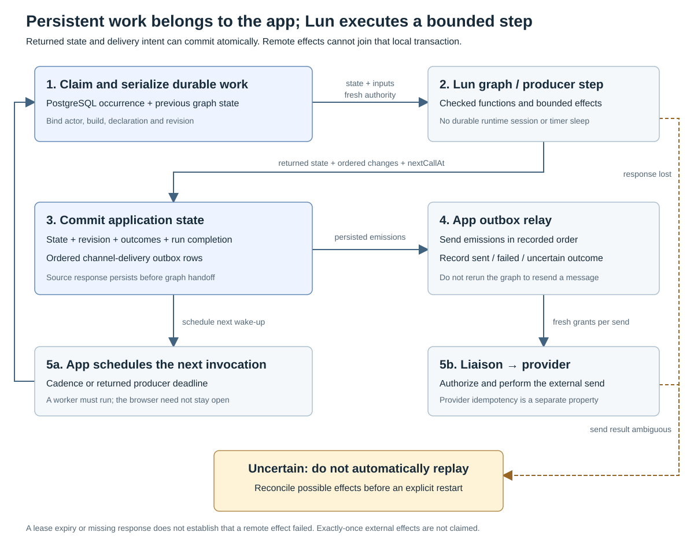

See [scheduling ownership and recovery](scheduling-ownership.md).

## Lode

Lode produces **both the formal spec and the implementation**. The spec is the
declared Lean type signature, including the effect row. Lode writes the function
body and declares its signature in `lun.json`, preserving any caller-pinned
types or wiring and staying within platform effect bounds. It iterates with
compiler/LSP feedback and bounded Lun trials. The app controls adoption; Lun
checks that the published implementation matches the declaration and the
independent caller constraints.

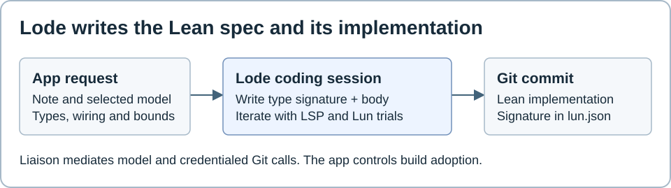

See the [Lode service contract](services/lode.md).

## Lun

Lun checks function signatures, effect rows and graph wiring, then compiles a
native driver for the build. A ready build runs without recompilation. A graph
step consumes caller-owned state and inputs, returning updated state, ordered
changes and `nextCallAt`. Warm workers keep loaded code, not durable state or the
previous call's authority.

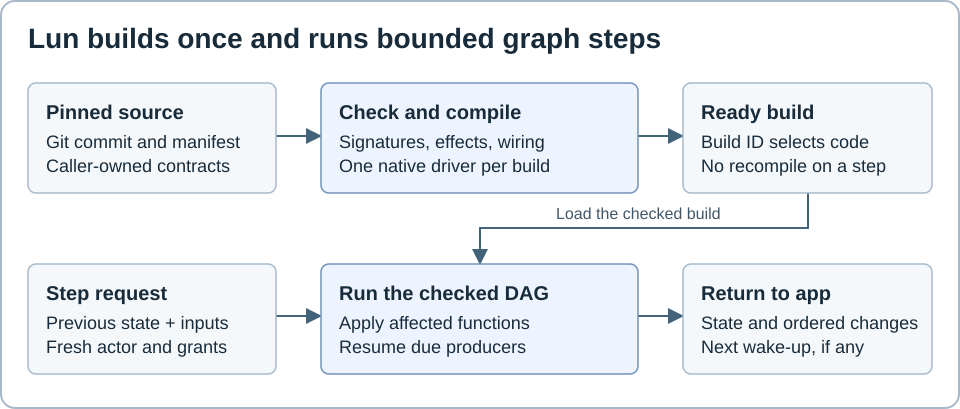

See the [Lun contract](services/lun.md). Reusing native cell objects across
different builds is a [separate proposal](cell-packages.md), not the current driver model.

## Linen

Linen is a linked Lean library, not a network service. It provides typed
effects and capability evidence, reactive graphs, and systems primitives.
Lun chooses the graph operators and handlers it admits; linking Linen does
not grant a program every operator or system effect the library supports.

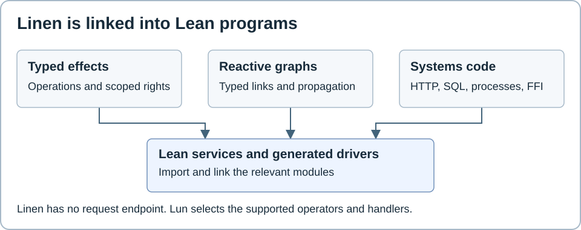

See the [Linen repository](https://github.com/typednotes/linen) and the
[proof strategy](proof-strategy.md).

## Liaison

Liaison executes named, scoped connector operations for the app, Lode and Lun,
not arbitrary provider URLs. It verifies the signed warrant and independent live ceilings, reserves
credit, looks up the credential, and uses a provider adapter. It records the
outcome and settles or releases the hold as appropriate. For calls from
generated code, Lun separately constrains execution to the compiled `Eff`
capability. App OAuth/bootstrap and bounded local effects are not broker calls.

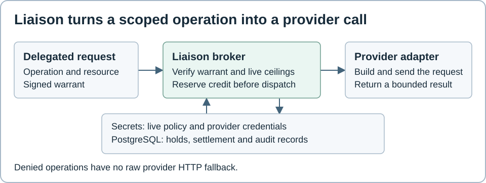

See [native connectors](native-connectors.md) and
[authority boundaries](system-architecture.md#5-authority-credentials-and-effect-boundaries).

## Paired messaging

Liaison can host native Signal and WhatsApp linked-device adapters in its own
process. Owner/admin pairing and unlinking are separate from scoped message
reads and sends; pairing does not grant sending. The broker owns the device
session and bounded recent-message store; the app owns durable project inbox
cursors. Availability requires native libraries and persistent encrypted
device storage, not just a successful service build.

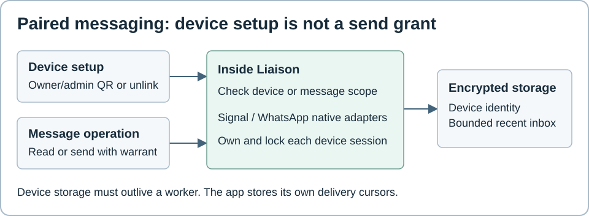

See [linked devices and deployment prerequisites](paired-messaging.md).

## Secrets

Secrets is the vault. It authenticates service identities, checks path policies,
and stores protected values behind an encrypted PostgreSQL barrier. The app
writes provider credentials but cannot read them back. Liaison reads or
refreshes them for authorized operations. Lun uses a separate identity on
its bounded compute and graph-secret paths.

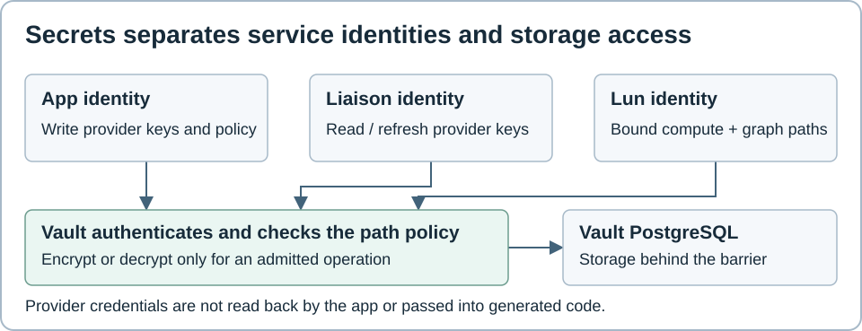

See the [Secrets service contract](services/secrets.md).

## Ledger

Ledger defines the credit, hold and usage tables. The app grants credits
and Liaison reserves and settles through shared SQL; there is no synchronous
billing service call per connector operation. The Ledger process sweeps expired
holds and serves health. This division of work does not guarantee exactly-once
provider effects or establish a provider's actual invoice.

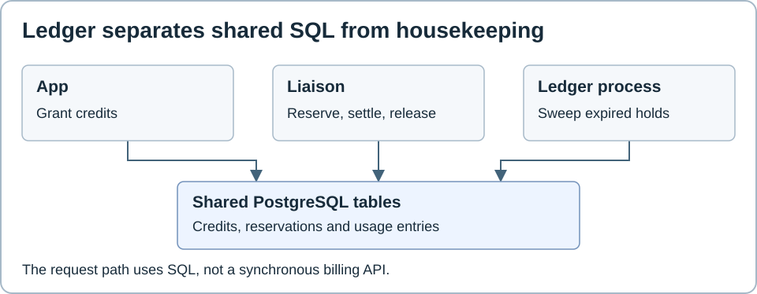

See the [Ledger service contract](services/ledger.md).

## Deployment

[`infra`](https://github.com/typednotes/infra) plans and applies typed
infrastructure. [`typednotes-infra`](https://github.com/typednotes/typednotes-infra)
selects the fleet, service access, images and migrations;
[`typednotes-lite`](https://github.com/typednotes/typednotes-lite) publishes the
combined Lite and Local images. Publication and deployment are different
operations.

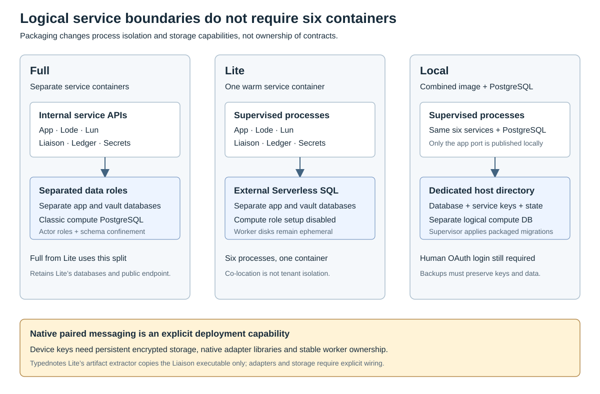

Lite does not provision actor-bound compute roles; Full and Local support
them. **Full from Lite** separates the services while retaining Lite's
databases and public endpoint. The [fleet declaration](https://github.com/typednotes/typednotes-infra#lite-deployment-default)
is the authority for supported topologies; these figures do not establish what
is deployed at any particular endpoint.

For request-level flows, data ownership and trusted boundaries, see the
[implemented system architecture](system-architecture.md).
